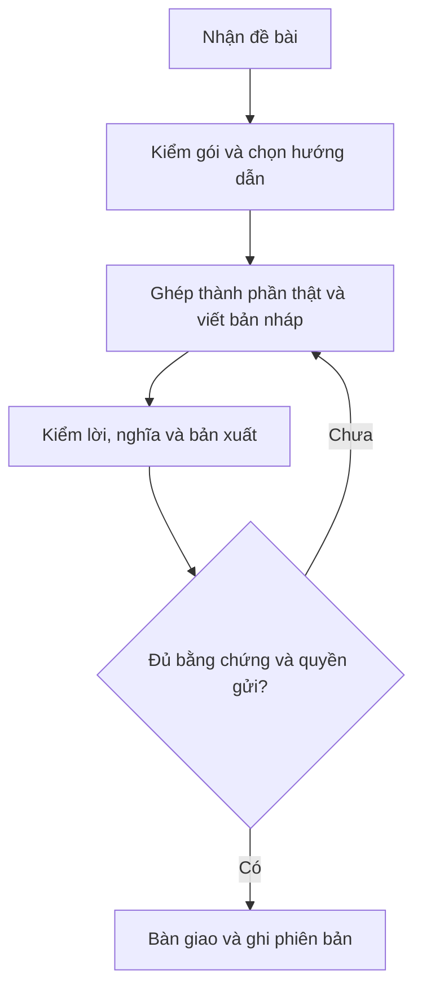

# Quy trình sử dụng

## GitHub + integration update

Release GitHub pinned/hash verified → inspect client OS/target → preview → client confirmation → apply → actual discovery and task check. See INSTALL.md. Source UI baseline unchanged; custom elements follow separate versioned library.
